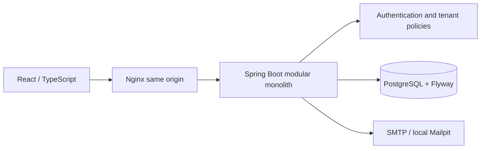

# TeamFlow

A multi-tenant project management SaaS built with Java 21, Spring Boot, React/TypeScript and PostgreSQL. One person can belong to several organizations with different permissions. Private projects, tasks, comments, activity and analytics enforce organization and project boundaries.

This is an implemented modular-monolith MVP, with hardening tracked in [PROGRESS.md](PROGRESS.md). It is **not publicly deployed**. See the [verification report](docs/VERIFICATION.md) for observed results and limitations.

## Features

- Registration, email verification, login, rotated sessions, logout, password recovery and profile management.
- Organization creation/switching, email invitations, membership roles, ownership transfer, leaving and archival.
- Organization-visible/private projects, project roles, paginated search/filter/sort, editing and archival.
- Persisted tasks with assignment, priorities, dates, estimates, locked human-readable task counters and optimistic conflict detection.
- dnd-kit Kanban status/order persistence, optimistic updates, rollback, keyboard controls and task details.
- Comments, structured activity, scoped notifications, restricted audits and database-backed dashboards/charts.

No demo accounts or fake data are inserted. Create an account to start. Automated browser tests create synthetic accounts only in a separate test stack.

## Start locally

For **Windows development without Docker**, use the [native local setup](docs/deployment/LOCAL_WINDOWS.md). On this machine, run `powershell -ExecutionPolicy Bypass -File scripts/start-local.ps1 -SkipBuild`; stop it with `scripts/stop-local.ps1`. The frontend, backend, database and development inbox run as local processes.

### Docker option (for later)

Requirements: Docker Desktop/Engine with Compose **2.24.4+**. Development outside Docker also requires Java 21 and Node 24; Maven is supplied by the wrapper.

```powershell
Copy-Item .env.example .env
# Edit .env: set DATABASE_PASSWORD to a unique local value.
docker compose up -d --build --wait
```

| Service | Local URL |
|---|---|
| Application | http://localhost:5173 |
| Health | http://localhost:8080/actuator/health |
| Development email inbox | http://localhost:8025 |
| Development Swagger | http://localhost:8080/swagger-ui/index.html |

Mailpit receives real local SMTP messages. Verification, invitation and password-reset links appear there. Delivery failures reject the operation. Production requires a real SMTP provider. The ignored `.env` is required; no database password is committed. `docker compose down` stops services and retains PostgreSQL data.

### Develop outside Docker

Stop Compose backend/frontend first if they occupy ports 8080/5173. From repository root:

```powershell
docker compose up -d db mailpit
$env:DATABASE_PASSWORD = '<the password from your .env>'
$env:SPRING_PROFILES_ACTIVE = 'dev'
$env:SMTP_HOST = 'localhost'
$env:DEBUG = 'false'
Set-Location backend
.\mvnw.cmd spring-boot:run
```

In another terminal, run `npm ci` and `npm run dev` inside `frontend`. Vite proxies `/api` to Spring Boot. Production uses Nginx with the same origin. Access tokens stay in memory; refresh tokens stay in an HttpOnly cookie.

## Verification

```powershell
Set-Location backend
.\mvnw.cmd -B -ntp verify
Set-Location ../frontend
npm ci
npm run lint
npm run typecheck
npm run test:coverage
npm run build
```

Backend integration tests require Docker and use Testcontainers PostgreSQL 17, never H2. Reports: `backend/target/site/jacoco/index.html` and `frontend/coverage/index.html`. Security-policy gates require 90% line / 70% branch coverage. Frontend thresholds cover shared forms/permission logic and are not a claim of whole-application coverage.

### Real browser tests

```powershell
# Separate Compose project = separate PostgreSQL volume/network.
docker compose -p teamflow-e2e -f docker-compose.yml -f docker-compose.e2e.yml up -d --build --wait
Set-Location frontend
npx playwright install chromium
npm run test:e2e
```

Test application: http://localhost:5174. Test email: http://localhost:8026. Journeys use real APIs and PostgreSQL without mocked network responses. They cover email invitations, private-project denial/membership, assignment, pointer dragging, persistence after reload, comments, notifications, activity, mobile navigation, cross-organization denial and password reset. Failure traces/screenshots stay under `frontend/test-results`; screenshots are captured under `docs/screenshots`.

GitHub Actions runs backend build/tests/coverage, frontend lint/types/tests/build, npm audit, Docker image builds and browser journeys. A remote CI pass is only established after the workflow runs on GitHub.

## Architecture



Every resource query uses tenant and parent IDs. Current membership determines permissions; composite foreign keys reject cross-tenant relationships. Organization Viewers cannot gain write permissions through project roles. Private projects require membership except for organization Owners/Admins. Versions detect stale writes. Organization row locks serialize initial tenant writes and membership changes, deliberately trading per-organization throughput for clear concurrency behavior.

JPA/Hibernate owns account persistence and mapping validation. Tenant modules use Spring `JdbcClient` with typed DTO projections and explicit SQL so tenant predicates, row locks and aggregates remain reviewable. Both share Spring transactions and a connection pool. No Hibernate filter is treated as a security boundary.

Read [architecture decisions](ARCHITECTURE.md), [ER/schema design](docs/database/README.md), [API and permissions](docs/api/README.md), [threat model](docs/architecture/THREAT_MODEL.md), [deployment/backups](docs/deployment/README.md), [demo workflow](docs/screenshots/README.md), and [contribution rules](CONTRIBUTING.md).

## Release boundaries

Single-instance throttling needs a shared limiter before horizontal scaling. HTTPS, production email, backups, monitoring and hosting require operator configuration. Archival retains history indefinitely; restoration and scheduled purging remain future work. SMTP is synchronous inside transactions; a transactional outbox is a planned reliability improvement. Boards load 100 tasks per page with “Load more”; analytics aggregate in PostgreSQL. Billing, uploads, realtime collaboration and Redis are outside this MVP.

The broader roadmap still includes advanced manager/date filters, an invitation inbox, account-disablement administration, broader form/board unit coverage, and extended accessibility/performance audits. These are tracked as incomplete, not implied working features.
