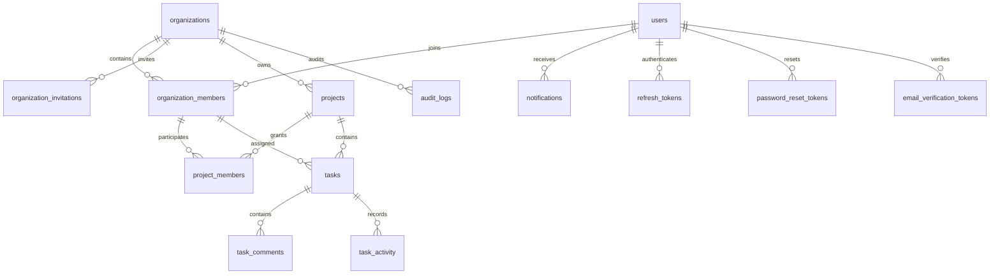

# Database design

Global accounts are separated from organization membership. Composite foreign keys enforce tenant consistency on project membership, tasks, assignments, comments and activity. UUIDs are not authorization controls. Organization IDs are required in scoped repository operations.

Indexes begin with organization/project IDs and support status, assignment, ordering and timestamps. Email and organization/project keys have uniqueness constraints. Foreign-key indexes prevent expensive joins and integrity checks. Paginated endpoints sort deterministically. Task counters and refresh families use row-level locking; task versions detect stale writes.

Migrations are append-only under `backend/src/main/resources/db/migration`. Hibernate never creates or updates production tables. Back up PostgreSQL before applying changes; use forward migrations to recover a failed release. See deployment documentation for backup and restore commands.
